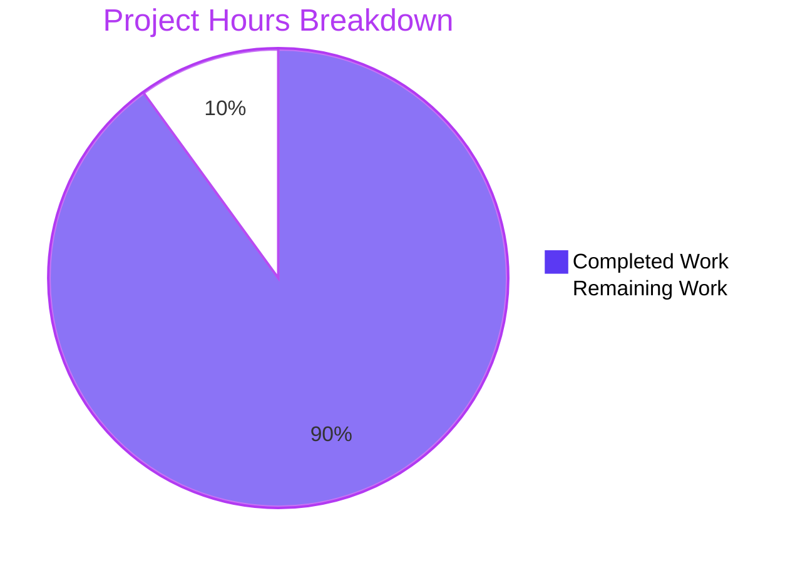

# 1. Executive Summary

## 1.1 Project Overview

Simple_JS_2 is a single-file Node HTTP server that answers every request with `Hello, World!`. This delivery was documentation-only: one JSDoc summary line describing the request handler in `helloworld.js`, and a five-line `README.md` giving the project name, the no-install fact and the command that starts the server. No logic, structure or dependency changed and no third file was added. The value is a repository that explains itself in the five lines a reader will read.

## 1.2 Completion Status

**90% complete — 9.0 of 10.0 hours.**



| Metric | Hours |
|---|---|
| Total Hours | 10.0 |
| Completed Hours (AI + Manual) | 9.0 |
| Remaining Hours | 1.0 |

All thirteen requirements — eleven documentation, two path-to-production — are complete and verified; the remaining hour is the publish step in Section 2.2.

## 1.3 Key Accomplishments

- ✅ Handler documentation — one JSDoc summary line describes the request handler (`helloworld.js:1`)
- ✅ Entry documentation — a five-line README gives the name, the no-install fact and the run command (`README.md`)
- ✅ Program untouched — the executable statement is byte-for-byte identical to its pre-change form (`c1ce18e`, `29dfc01`)
- ✅ Documented start path works — `node helloworld.js` prints one readiness banner and binds port 3000
- ✅ Response verified — 200, `Content-Length: 14` and the exact body on every path and method, identically after a restart
- ✅ Clean lifecycle — SIGTERM exits 143, the port is released, no process survives
- ✅ Scope containment — no manifest, dependency, test, CI or configuration file was introduced

## 1.4 Critical Unresolved Issues

**0 of 2 requested changes remain unresolved.** Four items carry forward — three accepted caveats on the handler comment and one capability never rendered — and none blocks publication.

| Issue | Impact | Owner | ETA |
|---|---|---|---|
| The handler comment says "plain-text body" but the response declares no `Content-Type` (headers are `connection`, `content-length`, `date`, `keep-alive`) | A strict client sees no declared type; browsers infer `text/plain` and decode as windows-1252. No data is exposed | Repository owner (decision only) | No action available under the current specification |
| The comment quotes the greeting as `'Hello, World!'` while the handler writes 14 bytes ending in a newline | Cosmetic; the greeting itself is exact | Repository owner (decision only) | No action available under the current specification |
| The JSDoc block sits above an expression statement whose handler is an anonymous inline arrow, so JSDoc tooling attaches it to no declarable symbol | The comment documents the handler for readers, not for documentation tooling | Repository owner | Only if the handler is ever extracted |
| The README has never been rendered by a Markdown host — the repository contains no renderer | Formatting is verified from the source and its encoding, not from a rendered page | Repository owner | Covered by the publish step (Section 2.2) |

## 1.5 Access Issues

No access issues identified: no credentials, no external service, no repository permission beyond read access.

## 1.6 Recommended Next Steps

1. [Medium] Merge the documentation set to the default branch and confirm the five lines render on the landing view.
2. [Medium] Add a smoke-test gate running the syntax check plus the documented start-and-request assertions.
3. [Low] Decide whether to make the handler comment precise — declaring a content type and quoting the body's exact bytes — in a change that may touch the program.
4. [Low] Make the listen port configurable and replace the unhandled startup error if two instances ever share a host.
5. [Low] State the required Node runtime in the README if a prerequisite line ever comes into scope.

# 2. Project Hours Breakdown

## 2.1 Completed Work Detail

| Component | Hours | Description |
|---|---|---|
| README entry document | 1.0 | The five-line `README.md` created with the project name, the no-install statement and the run command (commit `29dfc01`) |
| Handler documentation | 0.5 | One JSDoc summary line added above the request handler, with the existing statement reproduced byte-for-byte (`helloworld.js:1`; commit `c1ce18e`) |
| Static conformance verification | 2.0 | Both files compared byte-for-byte with their specified contents; 36 checks covering line structure, encoding, headings, fences and links, the absence inventory and a placeholder sweep |
| Runtime validation | 4.0 | Syntax gate, the documented start path, a 52-check request matrix across eight paths and six methods, restart identity, shutdown and port release, plus a four-navigation browser pass |
| Documentation accuracy review | 1.5 | Each documented claim traced to the code it describes: project name, no manifest, no dependency, run command and handler behaviour |
| **Total** | **9.0** | |

Every row above delivers or proves a requirement of the specification: the two documentation requirements through the first two rows, and the remaining documentation requirements and both path-to-production requirements through the three verification rows.

## 2.2 Remaining Work Detail

| Category | Hours | Priority |
|---|---|---|
| Path to production — merge the documentation set to the default branch, confirm the five-line README renders as written on the repository landing view, and re-run the documented command from the merged state | 1.0 | Medium |
| **Total** | **1.0** | |

Nothing else is outstanding in the agreed scope. The risks in Section 6 name work that would harden the server — a test gate, a declared content type, a configurable port, request logging, a stated runtime — and every one of those sits outside the scope this delivery was given, so none of it carries hours here.

## 2.3 Hours Calculation

- Completed hours: 1.0 + 0.5 + 2.0 + 4.0 + 1.5 = **9.0**
- Remaining hours: **1.0** (the single publish step above)
- Total project hours: 9.0 + 1.0 = **10.0**
- Completion: 9.0 ÷ 10.0 = **90%**

Confidence is high: the scope is two files with fully fixed contents, so neither the completed nor the remaining estimate depends on an unknown. The remaining hour is a publishing action rather than engineering — merging, reading the rendered page and re-running one command — which is why it is the only hour left against a delivery whose every requirement is already complete and verified.

# 3. Test Results

| Area / Category | Framework | Tests | Passed | Failed | Coverage | What This Proves |
|---|---|---|---|---|---|---|
| Documentation conformance | POSIX `diff`, `cmp`, `od`, `grep` | 36 | 36 | 0 | n/a — no coverage tool is configured | Both files match their specified contents byte for byte, with the right line structure, encoding and heading counts, and no out-of-scope artifact exists |
| HTTP request handling | curl 8.x | 52 | 52 | 0 | n/a — no coverage tool is configured | The documented command yields 200 with the exact 14-byte body on every path and method, identically after a restart, with the encoded-script path reflected nowhere |
| Process lifecycle | shell, curl | 6 | 6 | 0 | n/a — no coverage tool is configured | SIGTERM shuts down cleanly with exit 143, the port is released, no process survives, and a second instance fails fast while the first keeps serving |
| Static syntax gate | `node --check` | 2 | 2 | 0 | n/a — no coverage tool is configured | Both files parse, and the repository's only static gate passes for its single script |
| Browser client | headless Chrome | 4 | 4 | 0 | n/a — no coverage tool is configured | The response renders as plain text at 200 on the root path, a deep path and an encoded-script path, with no console output, no failed request and no horizontal overflow at 375 px |
| **Total** | — | **100** | **100** | **0** | — | — |

**Not Covered**

- **The README as a rendered page.** The repository contains no Markdown renderer, so the five lines and their encoding were verified from the source; how a hosting platform lays them out has not been exercised. Reading the rendered page is the first half of the publish step in Section 2.2.
- **IPv6 loopback.** The runtime environment has IPv6 disabled, so only IPv4 paths were exercised; `[::1]:3000` was never reachable and no IPv6 claim is made anywhere.
- **Typed and UTF-8-strict clients.** The server declares no content type, so content negotiation cannot be exercised and a client that requires a declared type will see none.
- **Multi-instance hosting and sustained load.** Beyond a single contention probe and ten concurrent requests, the server was not run beside a second instance or under load.
- **Any automated regression protection.** The repository holds no test suite, so nothing guards a future edit to the program. After any change to `helloworld.js`, a human should run `node --check helloworld.js` and the single documented request assertion from Section 9.

# 4. Runtime Validation & UI Verification

- ✅ **Startup** — `node helloworld.js` prints exactly one 41-byte banner, `Server running at http://127.0.0.1:3000/`, and binds port 3000 on all interfaces
- ✅ **Primary request** — `GET /` returns `HTTP/1.1 200 OK`, `Content-Length: 14`, body `Hello, World!` followed by one newline
- ✅ **Arbitrary paths** — `/a`, `/a/b/c`, `/q?x=1`, `//double`, `/trailing/`, `/favicon.ico` and `/does/not/exist/deeply` all answer 200 with the same 14 bytes
- ✅ **Methods** — GET, POST, PUT, DELETE, OPTIONS and PATCH all answer 200 with the same body; HEAD answers 200 with the body suppressed by HTTP itself
- ✅ **Restart identity** — banner and body byte-identical across restarts and against the pre-change statement run side by side
- ✅ **Shutdown** — SIGTERM exits 143 with the port released and no surviving process; SIGINT exits 130
- ⚠ **Response typing** — no `Content-Type` is sent; the browser inferred `text/plain` and decoded as windows-1252
- ⚠ **Single instance** — a second instance exits 1 with an unhandled `EADDRINUSE` trace while the first keeps serving; no error handler exists by design
- ✅ **Browser rendering** — four navigations rendered exactly `Hello, World!` as preformatted plain text, with no console message, no failed request and no script execution
- ❌ **No user interface exists** — the server returns raw text with no HTML, CSS or client-side code, so there is no screen-level interface to verify; the response was proven end to end in a browser instead

Never exercised at runtime: IPv6 loopback (the environment provides none), a second instance under real traffic, clients that require a declared content type, and any external integration — the program has no database, broker, cache, queue or third-party service to drive. `PORT=4000` was set during one probe and the listener stayed on 3000, which confirms the program reads no configuration at all.

# 5. Compliance & Quality Review

## 5.1 Compliance Matrix

| Deliverable | Benchmark | Status | Verified By |
|---|---|---|---|
| README entry document | Content delivered exactly as specified | ✅ Pass | Byte comparison; 5 lines / 117 bytes; one heading; no link, image, badge, diagram or code fence |
| Handler documentation | Content delivered exactly as specified | ✅ Pass | `helloworld.js:1` byte-identical to the specified comment; single-line block with no tags |
| Program behaviour | No behaviour, structure or dependency change | ✅ Pass | Banner, port 3000 and 14-byte body identical across restarts and against the pre-change statement |
| Scope containment | Only the two mapped paths change | ✅ Pass | 2 tracked paths, 6 insertions, 0 deletions; absence inventory empty; no rename, reformat or refactor |
| Dependency posture | No install step, manifest, lockfile or runtime pin added | ✅ Pass | Absence probes; the sole load is the built-in `http` module |
| Rule compliance | No user-specified rule violated | ✅ Pass | No rule source exists in the project; the prose states behaviour without tags or embellishment |
| Comment quality | Comments state what the code cannot | ✅ Pass | One tag-free summary sentence; no placeholder, TODO or change-narration marker in either file |
| Security baseline | No secret, input surface or injection sink introduced | ✅ Pass | Both edits are inert text; the only URL is the loopback banner; no `eval`, `exec`, path or output sink |
| Documentation accuracy | Every documented claim true of the code | ✅ Pass | Five claims traced to a file or to a proven absence |
| Regression protection | Behaviour guarded by automated tests | ⚠ Gap — out of scope | No test suite, runner configuration, lint configuration or CI exists anywhere in the tree |
| Response typing | Consumers receive a declared content type | ⚠ Gap — accepted | No `Content-Type` is sent; the browser inferred `text/plain` with a windows-1252 fallback |
| Operability | Configurable port, graceful startup failure, request logging | ⚠ Gap — accepted | Port 3000 is a literal; a taken port raises an unhandled error trace; the startup banner is the only log line |

## 5.2 AAP & Rule Divergences and Gaps

No requirement was skipped, deferred or delivered differently from the value it specifies, and no user-specified rule exists for this project, so no rule departure is possible by construction. Three accepted caveats remain, all of them about one fixed sentence and its placement; they are recorded here because a reader comparing the comment with the bytes should know exactly how far the prose reaches.

| What the AAP/Rule Required | What Was Delivered Instead | Why It Diverged | Impact | Remediation |
|---|---|---|---|---|
| The comment must read exactly "…replies to every request with the plain-text body 'Hello, World!'…", and the program must not change (`AAP 0.3.1`, `0.4.2`) | That exact sentence at `helloworld.js:1`, above a response that declares no `Content-Type` | The fixed text and the ban on program changes conflict: making the prose precise would mean sending a header, which the out-of-scope list forbids. Settled in favour of the fixed text | Cosmetic — a strict client sees no declared type; browsers infer `text/plain`. No data is exposed, since the body is a constant | None available in the current scope. Close by declaring a content type and revising the sentence if the program may change |
| The comment must quote the body as `'Hello, World!'` (`AAP 0.3.1`) | The specified sentence, while `res.end` writes `Hello, World!\n` — 14 bytes | The newline belongs to the program and the sentence quotes the greeting; the fixed text left no room to adjust either side | Cosmetic — the greeting itself is exact; a reader comparing bytes finds one extra LF | None; a wording change is the only remedy and the text is fixed |
| One JSDoc summary line above the request handler (`AAP 0.3.1`) | That line above an expression statement whose handler is an anonymous inline arrow | The placement is fixed, and making the block attach to a declarable symbol would require extracting or naming the handler, which the out-of-scope list forbids | The comment documents the handler for readers but not for documentation tooling; no generated API documentation accrues | None; carry the comment with the handler if it is ever extracted |

All three share one settlement: where the fixed wording and the shape of the program disagreed, the wording won, because the two files' contents are the acceptance criterion and any program change was out of scope. Nothing in the code is wrong as a result — the handler does answer every request it receives with the greeting, and the comment describes that truthfully at the detail the sentence allows. The decision left to a human is whether to keep the agreed text, which this scope recommends, or to open a change that touches the program so the comment can name the exact bytes and the declared type.

# 6. Risk Assessment

| Risk | Category | Severity | Probability | Mitigation | Status |
|---|---|---|---|---|---|
| No automated tests or CI exist, so the server's behaviour is guarded by a syntax check alone and any future edit ships unverified | Technical | Medium | High for any later change | Add a smoke-test gate running the syntax check plus the documented start-and-request assertions | Open — accepted |
| Port 3000 is a hardcoded literal, so a second instance on the same host exits 1 with an unhandled error trace and no readable message | Operational | Medium | High wherever two instances meet | Run one instance per host under a supervisor, or make the port configurable in a future scope | Open — accepted |
| Every path and method returns 200 with the same body, so path-based health monitoring carries no signal and `/favicon.ico` returns the greeting | Operational | Medium | Certain | Probe the root path and assert the 14-byte body rather than a status alone | Open — by design |
| No `Content-Type` is declared, so a consumer that requires a typed response receives none and browsers fall back to windows-1252 | Integration | Low | Certain | Treat the body as plain ASCII text; declare a type only under a future scope | Open — accepted |
| No runtime version is stated anywhere — no version pin in the tree and no prerequisite line in the README | Technical | Low | Medium at onboarding | State the required Node release in the consuming environment or in a future prerequisite line | Open — accepted |
| The startup banner is the only operational output; there is no request trail and no error log, so a failure after boot leaves no trace in the program's own output | Operational | Low | Medium | Supervise the process and retain stdout and stderr outside the program | Open — accepted |
| The server has no authentication, no TLS and binds all interfaces on port 3000, so any client that can reach the port reads the greeting | Security | Low | Certain | Restrict network exposure at the host or a fronting proxy; the body is a constant string with no data behind it | Open — accepted |
| The JSDoc block attaches to no declarable symbol, so no API documentation accrues from it | Maintainability | Low | Certain | Carry the comment with the handler if it is ever extracted into a named function | Open — by design |

None of these risks is introduced by this delivery: every one is a property of the server as it was committed before the documentation work, and every remedy either touches the program — which the agreed scope forbids — or belongs to how the process is hosted.

# 7. Visual Project Status

Project status is summarised by hours against the agreed scope: 9.0 hours of completed, verified work and 1.0 hour of publishing left. Completed work is shown in Blitzy dark blue (#5B39F3) and remaining work in white (#FFFFFF).


| State | Hours | Share | Colour |
|---|---|---|---|
| Completed work | 9.0 | 90% | Dark blue #5B39F3 |
| Remaining work | 1.0 | 10% | White #FFFFFF |
| **Total** | **10.0** | **100%** | — |

| Remaining work by priority | Hours |
|---|---|
| High | 0.0 |
| Medium | 1.0 |
| Low | 0.0 |

No high-priority work remains: the single outstanding item is the Medium-priority publish step in Section 2.2.

# 8. Summary & Recommendations

This delivery documented Simple_JS_2 without changing it. `helloworld.js` gained one JSDoc summary line above the request handler, with the executable statement reproduced byte-for-byte so the server behaves exactly as it did before; `README.md` was created as a five-line entry document naming the project, stating that there is nothing to install and giving the command that starts the server. The change set is two files, six insertions and zero deletions, and it introduces no manifest, lockfile, dependency, test, configuration or CI file.

What was exercised to prove it works: 100 checks across five categories — 36 documentation-conformance checks, a 52-check HTTP matrix over eight paths and six methods, six lifecycle checks covering shutdown, port release and a second-instance contention probe, two syntax-gate checks, and four browser navigations. All passed. The documented start path was the only start path used throughout, the banner and the 14-byte body were byte-identical across restarts and against the pre-change statement, and the browser rendered the response as plain text with no console output and no failed request. Neither file contains a placeholder, TODO or change-narration marker.

Against the agreed scope the project is 90% complete: 9.0 of 10.0 hours. Every one of the thirteen requirements is met and verified; the remaining 1.0 hour is publishing — merging the documentation set to the default branch, reading the rendered README on the landing view, and re-running the documented command from the merged state. That is the critical path to production, and nothing else stands between the codebase and a published, self-explaining repository.

Production readiness, stated precisely: the documentation is ready to publish, and the server is ready for the purpose it documents — a deterministic, dependency-free greeting service that boots with one command, needs no configuration, answers every request with the same 14 bytes and shuts down cleanly. It is not ready for multi-instance hosting, for path-based health monitoring, or for clients that require a declared content type, and it carries no automated regression protection; each of those sits outside the scope this delivery was given and is recorded in Sections 3, 5.2 and 6 so the decision to close them can be taken deliberately rather than by surprise.

Success measures a reviewer can re-run: both files byte-identical to their specified contents; 100 of 100 recorded checks passing; exactly two tracked paths with zero deletions; zero dependencies; and one command that starts a server which answers with `Hello, World!` in every case that reaches it.

# 9. Development Guide

## 9.1 System Prerequisites

- A Node.js runtime on `PATH`. Verified on **v22.23.5**; the program uses only the built-in `http` module and needs no package manager, compiler or service.
- No database, cache, broker, queue or external API. No environment variable is read.
- Port **3000** free on the host. The port is a literal in the source, so one instance per host is the practical limit.

```bash
node --version
# v22.23.5
```

## 9.2 Obtaining the Project

The repository holds exactly two tracked files and no submodule, so a plain clone is all that is needed.

```bash
git clone <repository-url> Simple_JS_2
cd Simple_JS_2
git ls-files
# README.md
# helloworld.js
```

## 9.3 Dependency Installation

There is nothing to install. The single module the program loads is Node's built-in `http`, and the repository deliberately contains no manifest, lockfile or `node_modules`, so `npm install` has nothing to run and `npm start` will fail because no manifest exists. The syntax check below is the whole build:

```bash
node --check helloworld.js
echo "exit=$?"
# exit=0
```

## 9.4 Startup

Run the file with Node. It blocks the terminal, so either keep it in its own terminal or start it in the background and keep the process id.

```bash
node helloworld.js
# Server running at http://127.0.0.1:3000/
```

Background form:

```bash
node helloworld.js > server.log 2>&1 &
echo $!            # record the process id for the shutdown step
cat server.log     # Server running at http://127.0.0.1:3000/
```

The banner is exactly one line of 41 bytes on stdout; nothing is written to stderr, and the process writes no files.

## 9.5 Verification Steps

Request the root path and read the full response:

```bash
curl -s -i http://127.0.0.1:3000/
# HTTP/1.1 200 OK
# Date: Mon, 16 Nov 2026 14:11:33 GMT
# Connection: keep-alive
# Keep-Alive: timeout=5
# Content-Length: 14
#
# Hello, World!
```

There is no `Content-Type` header: browsers sniff the body as plain text. Check the status and body size on any path:

```bash
curl -s -o /dev/null -w 'status=%{http_code} bytes=%{size_download}\n' http://127.0.0.1:3000/does/not/exist
# status=200 bytes=14
```

Confirm the listener without `lsof` or `ss`, which are not present on every host:

```bash
awk 'NR>1 && $4=="0A" {split($2,a,":"); if (a[2]=="0BB8") print "LISTEN on port 3000"}' /proc/net/tcp6
# LISTEN on port 3000
```

Whole-repository static gate — the only automated check the project has:

```bash
for f in $(git ls-files '*.js'); do node --check "$f"; echo "$f: exit=$?"; done
# helloworld.js: exit=0
```

## 9.6 Example Usage

Every path and method returns the same body, so any request is a valid example:

```bash
curl -s http://127.0.0.1:3000/
# Hello, World!

curl -s -X POST http://127.0.0.1:3000/anything
# Hello, World!

curl -s -I http://127.0.0.1:3000/          # HEAD: 200, body suppressed by HTTP
# HTTP/1.1 200 OK
```

A browser pointed at `http://127.0.0.1:3000/` shows a single line, `Hello, World!`, rendered as preformatted plain text at any viewport width.

## 9.7 Stopping the Server

Stop the process by its own id — never by name, since other Node processes may be running on the same host.

```bash
kill -TERM <pid>
wait <pid>
# exit=143
```

After shutdown the port is free again; a request to it fails with `curl: (7) Failed to connect` (exit 7). Interrupting a foreground start with Ctrl-C exits 130.

## 9.8 Troubleshooting

| Symptom | Cause | Resolution |
|---|---|---|
| `Error: listen EADDRINUSE: address already in use :::3000` and a `node:events` trace, exit 1 | Another instance is already serving port 3000; the program has no error handler, so Node prints its default trace | Reuse the running instance (`curl -s http://127.0.0.1:3000/`) or stop the process that owns the port, then start again |
| `curl: (7) Failed to connect to 127.0.0.1 port 3000` | The server is not running, or has already been stopped | Start it and wait for the banner before requesting; confirm the listener with the `awk` probe in Section 9.5 |
| `npm start` fails with `ENOENT … package.json` | The project has no manifest by design | Use `node helloworld.js`; do not add a manifest to work around it |
| `lsof` or `ss` not found | Neither tool is installed on every host | Use the `/proc/net/tcp6` probe in Section 9.5 |
| Response has no content type and a client shows the wrong encoding | The server declares no `Content-Type`; browsers fall back to windows-1252 | Treat the body as plain ASCII text; the bytes are always `Hello, World!` plus a newline |
| Only one instance can run | Port 3000 is hardcoded in the source | Run one instance per host; making the port configurable requires a source change outside the current scope |

# 10. Appendices

## A. Command Reference

| Command | Purpose | Expected Result |
|---|---|---|
| `node --version` | Confirm the runtime | Prints a version such as `v22.23.5` |
| `node --check helloworld.js` | Syntax check without executing | No output, exit 0 |
| `for f in $(git ls-files '*.js'); do node --check "$f"; done` | Whole-repository static gate | No output, exit 0 for the single script |
| `node helloworld.js` | Start the server | Prints `Server running at http://127.0.0.1:3000/` and blocks |
| `curl -s -i http://127.0.0.1:3000/` | Full response of the root path | `HTTP/1.1 200 OK`, `Content-Length: 14`, body `Hello, World!` |
| `curl -s -o /dev/null -w 'status=%{http_code} bytes=%{size_download}\n' <url>` | Status and body size for any path | `status=200 bytes=14` |
| `awk 'NR>1 && $4=="0A" {split($2,a,":"); if (a[2]=="0BB8") print "LISTEN on port 3000"}' /proc/net/tcp6` | Confirm the listener without `lsof`/`ss` | `LISTEN on port 3000` |
| `kill -TERM <pid>` then `wait <pid>` | Stop the background server | Exit status 143, port released |

## B. Port Reference

| Port | Protocol | Bound Address | Notes |
|---|---|---|---|
| 3000 | TCP (HTTP) | All interfaces (`::`) | Hardcoded literal in `helloworld.js:2`. One instance per host; a second start exits 1 with `EADDRINUSE`. No TLS, no authentication. `PORT` is ignored |

## C. Key File Locations

| Path | Role |
|---|---|
| `helloworld.js` | The whole program: one JSDoc summary line documenting the handler, then the single statement that creates the server, binds port 3000 and logs the readiness banner |
| `README.md` | The entry document: project name, the statement that nothing needs installing, and the run command |
| — | No other tracked path exists: no manifest, lockfile, dependency, test, configuration, CI, ignore or documentation file |

## D. Technology Versions

| Component | Version | Source |
|---|---|---|
| Node.js | v22.23.5 (verified in this environment) | `node --version` |
| `http` module | Node built-in — no package version applies | `helloworld.js:2` |
| Third-party dependencies | None | No manifest, lockfile or `node_modules` in the tree |
| Build, test, lint and CI tooling | None | The only static gate is `node --check` |
| Browser used for client verification | Chrome (headless, current stable) | Response rendered as `text/plain`, `Content-Length: 14` |

## E. Environment Variable Reference

The program reads no environment variable. Setting `PORT=4000` before startup leaves the listener on 3000 and leaves 4000 refusing connections, which was confirmed by probe. No variable needs to be set to run, test or stop the server, and no secret or credential is referenced anywhere in the tree.

## G. Glossary

- **JSDoc summary block** — a `/** … */` comment stating what a function or handler does; here a single tag-free line above the request handler.
- **Inline arrow handler** — the anonymous `(req,res)=>res.end('Hello, World!\n')` passed to `http.createServer`; the sole request listener.
- **Readiness banner** — the one 41-byte line `Server running at http://127.0.0.1:3000/` printed to stdout when the listener is up.
- **Byte-identical** — compared with `cmp` or `diff` and producing no difference; the basis on which the pre-existing statement and both documents were verified.
- **Conformance check** — a comparison of a file's actual bytes, line structure or encoding against the content it is required to contain.
- **`EADDRINUSE`** — the operating-system error raised when a port is already taken; here it surfaces as an unhandled Node error trace because the program has no error handler.
- **`Content-Length`** — the response header carrying the body's size in bytes; always 14 for this server.
